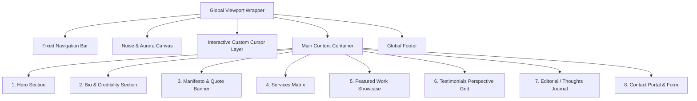

# Website Structure Specification — Phase 0

This document defines the complete structural blueprint, section hierarchy, content layout, and responsive distribution for rebuilding Suraj Meena's creative developer portfolio.

---

## Complete Section Hierarchy

---

## Section-by-Section Content & Layout Breakdown

### 1. Navigation Bar
- **Position**: `fixed`, `top: 0`, `z-index: 50`.
- **Background**: Translucent `#05050A` at 85% opacity with 20px blur and bottom border `rgba(124, 58, 237, 0.08)`.
- **Layout**: Flexbox, full width, padded `1.5rem 5%`.
  - **Left**: Brand logo text `"SURAJ"` / `"FRAME FLICKS"` in Bebas Neue / Archivo Black with gradient fill.
  - **Right**: Unordered list of anchor links:
    - `About` (`#bio-section`)
    - `Services` (`#services`)
    - `Work` (`#work-section`)
    - `Contact` (`#contact`)
  - **Mobile State**: Hamburger icon (`3 lines`) expanding into full-screen drawer.

---

### 2. Section 1: Hero Section (`#hero-section`)
- **Container Layout**: Min-height `100vh`, flex column centering, relative position, z-index 1.
- **Background Layer**:
  - Three rotating radial blur aurora orbs (Violet `#7C3AED`, Cyan `#06B6D4`, Pink `#EB4D6D`).
  - Subtle radial grid overlay (`30px` grid).
- **Foreground Content**:
  - **Eyebrow Pill**: `"VIDEO EDITOR & VISUAL STORYTELLER"` with 40px cyan accent rule.
  - **Primary Kinetic Display Title**:
    - Line 1: `"SURAJ"` (massive scale, Bebas Neue / Archivo, `clamp(70px, 11vw, 150px)`).
    - Line 2: `"MEENA"` with iridescent gradient text fill and subtle glitch ghost overlays.
    - Floating Badge / Sub-heading: `"©2026 / CREATING SINCE 2024"`.
  - **Sticky Avatar Anchor / 3D Hologram**:
    - Floating 3D holographic element (`holo_triangle_rounded`).
    - Rotating circular text: `"VIDEO EDITOR • FRAME FLICKS • "`.
  - **Action Group (CTA)**:
    - Primary Magnetic Button: `"View My Work"` (`#work-section`).
    - Secondary Magnetic Outline Button: `"Let's Collaborate"` (`#contact`).
  - **Scroll Indicator**: Vertical pulsing line with `"SCROLL"` text label.

---

### 3. Section 2: Bio & Credibility Section (`#bio-section`)
- **Layout**: 2-column asymmetric desktop grid (1fr : 1fr), collapsing to single-column on `< 768px`.
- **Left Column — Story & Vision**:
  - Eyebrow: `[WHO I AM]` in cyan uppercase.
  - Heading: `"The Editor Behind the Frame"`.
  - Narrative Paragraphs:
    - *"Hello! I'm Suraj Meena, a motion designer and visual editor based in Gandhinagar, currently running Dincharyaaaa — sharing editing and filmmaking with other creatives."*
    - *"With 2+ years of experience since 2024, focused on turning raw footage into work that holds attention — from music videos to content series to motion graphics."*
    - *"I work across After Effects and Premiere Pro, handling everything from cut and color to compositing and title design."*
  - **Live Animated Counters (Metrics Row)**:
    - `3+` / `2+` — Years Specialization
    - `100%` — Passion Driven
    - `24/7` — Creative Mode
- **Right Column — Sticky Avatar Card & Toolchain Skills**:
  - **Interactive 3D Avatar Card**: Front photo (`Portrait of creator`) flipping to back photo on scroll.
  - **Skill Bars**:
    - DaVinci Resolve — 82%
    - Adobe After Effects — 85%
    - Premiere Pro — 90%
    - Visual Storytelling — 95%
  - **Pill Tags**: `Cinematic Edits`, `Music Videos`, `Brand Content`, `Short-form Reels`, `Kinetic Typography`.

---

### 4. Section 3: Cinematic Manifesto / Quote Banner
- **Layout**: Full-width statement container with top and bottom gradient divider rules.
- **Typography**: Large editorial italic and bold text (`clamp(24px, 3.5vw, 42px)`).
- **Content**:
  > *"From raw footage to the final cut. Motion and edits built to hold attention, move with intent, and feel considered from music videos to content series to full brand motion."*

---

### 5. Section 4: Services Matrix (`#services`)
- **Layout**: 4-card grid (desktop: 2x2 or 4x1; tablet: 2x2; mobile: 1 column).
- **Cards Detail**:
  1. **Motion Graphics**:
     - *Icon*: 🎬 / Abstract Motion
     - *Categories*: Title Design • Kinetic Type • Compositing
     - *Link*: `"Get in Touch →"`
  2. **Video Editing**:
     - *Icon*: ⚡ / Timeline Cut
     - *Categories*: Music Videos • Content Series • Colour Grading
     - *Link*: `"Get in Touch →"`
  3. **Social Media Reels**:
     - *Icon*: 📐 / Mobile Ratio
     - *Categories*: Short-Form Cuts • Brand Content • Fast Turnaround
     - *Link*: `"Get in Touch →"`
  4. **Motion Design & VFX**:
     - *Icon*: 🔮 / Hologram
     - *Categories*: Particle Systems • Visual Effects • Brand Motion
     - *Link*: `"Get in Touch →"`
- **Pricing / Scope Footer Banner**:
  - Text: *"All pricing is custom — based on your project scope, raw footage volume, and timeline."*
  - CTA Button: `"Request a Quote"` (`#contact`).

---

### 6. Section 5: Featured Projects Showcase (`#work-section`)
- **Layout**: High-impact editorial showcase with full-width video player and dynamic card grid.
- **Primary Video Showcase**:
  - Embedded 16:9 YouTube Showreel (`QgXMgYHXRsQ`).
  - Badge: `"Showreel 2025"`.
- **4 Featured Project Cards with Auto-Playing Video Previews**:
  1. **Tum Aaye Ho**:
     - *Format*: Lyrical Music Video
     - *Summary*: Official lyrical music video crafted using Adobe After Effects, Premiere Pro, and Photoshop.
     - *Video Preview*: `8l3s5RhvfTEPRgpWKOBeyWxyYtE.mp4`
  2. **M & M Restro and Cafe**:
     - *Format*: Commercial Destination Showcase
     - *Summary*: Dynamic hospitality video highlighting ambiance and culinary craft.
     - *Video Preview*: `0gj3NRHr047udzj7z9Kfu0SHPQ.mp4`
  3. **Mazuri**:
     - *Format*: Food & Culture Promo
     - *Summary*: High-energy cinematic promo ("Dum Biryani").
     - *Video Preview*: `ypAbnrLXX7m9JDIQMNq9LPTtI.mp4`
  4. **Nav Nirmaan**:
     - *Format*: Documentary / Non-profit Film
     - *Summary*: Moving storytelling for Nav Nirmaan NGO.
     - *Video Preview*: `qvrETYIJKXTwCs9RrkwzaVkd5M.mp4`
- **External Channels CTA**:
  - Links to Instagram (`@_frame_flicks_00` & `@_dincharyaa`) and YouTube (`@dincharyaaaa`).

---

### 7. Section 6: Testimonials Section
- **Layout**: 4-card perspective grid with 3D hover reaction.
- **Card Contents**:
  - *Yakoub Kashmiri* (Marketing Director)
  - *Daniel K.* (Indie Maker)
  - *Mark M.* (Startup Founder)
  - *Omar H.* (Frontend Developer)

---

### 8. Section 7: Thoughts & Editorial Journal (`#articles`)
- **Layout**: 3-card horizontal list.
- **Content**:
  1. *Building Trust Through Clear Design* (May 5, 2025)
  2. *The Role of Art Direction in Branding* (Jun 16, 2025)
  3. *How Creative Teams Build Brand Systems* (Jun 16, 2025)

---

### 9. Section 8: Contact Portal (`#contact`)
- **Layout**: 2-column split (Left: Contact Info; Right: Interactive Form).
- **Left Column**:
  - Email: `surajmeenam946@gmail.com`
  - Instagram (Business): `@_frame_flicks_00`
  - Instagram (Personal): `@thesurajmeenaa` / `@_dincharyaa`
  - YouTube: `@dincharyaaaa`
  - X / Twitter: `@code_crafter_00`
  - Status Box: *"Currently accepting new projects. Drop a message with your project details, and I'll get back to you within 24 hours."*
- **Right Column (Form)**:
  - Input: Name
  - Input: Email
  - Input: Project Type (YouTube, Cinematic, Commercial Ad, Motion Graphics)
  - Textarea: Project Details
  - Submit Button with animated success state.

---

### 10. Global Footer
- **Layout**: Flex row, spaced between, padded `3rem 5%`.
- **Left**: Brand logo mark (`FRAME FLICKS` / `SURAJ`).
- **Center**: Quick Links (`Home`, `About Me`, `Services`, `Works`, `Contact`).
- **Right**: Copyright notice (`© 2026 Suraj Meena — All rights reserved`).
